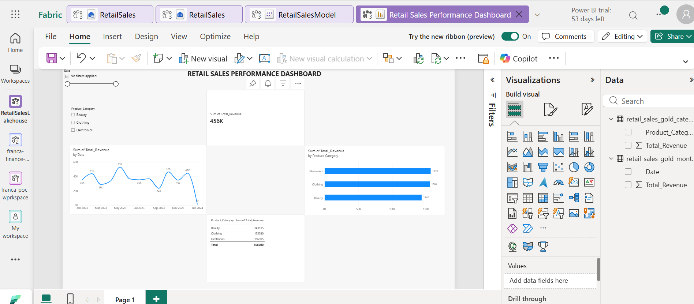

# Retail-Sales-Fabric-Project# Retail Sales Data Engineering and Analytics Using Microsoft Fabric

## Project Overview

This project demonstrates an end-to-end data engineering and analytics workflow using a retail sales dataset obtained from Kaggle.

The objective was to ingest, clean, transform, store, query, and analyse retail sales data using Python, Microsoft Fabric Lakehouse, SQL Analytics Endpoint, and Power BI.

The project follows the Medallion Architecture (Bronze, Silver, and Gold) to organise data processing and transformation.

## Project Objectives

- Download and prepare a retail sales dataset.
- Perform data cleaning and validation using Python and Pandas.
- Implement Bronze, Silver, and Gold data layers in Microsoft Fabric.
- Create analytical tables for monthly revenue and product category performance.
- Query and validate results using the SQL Analytics Endpoint.
- Build an interactive Power BI dashboard.

## Technologies Used

| Technology | Purpose |
|---|---|
| Python | Data processing and transformation |
| Pandas | Data cleaning and analysis |
| Jupyter Notebook | Python development environment |
| Kaggle | Dataset source |
| Microsoft Fabric | Data engineering platform |
| Fabric Lakehouse | Data storage |
| SQL Analytics Endpoint | Data querying and validation |
| Power BI | Data visualisation and reporting |

## Dataset Description

The project uses a retail sales dataset containing 1,000 transactions and nine columns.

The dataset includes:

- Transaction ID
- Date
- Customer ID
- Gender
- Age
- Product Category
- Quantity
- Price per Unit
- Total Amount

**Dataset source:** [Insert the original Kaggle dataset link here.]

## Data Architecture

The project implements the Medallion Architecture.

### Bronze Layer – Raw Data

The original retail sales data was uploaded into Microsoft Fabric Lakehouse.

Table: `retail_sales_bronze`

### Silver Layer – Cleaned Data

Python and Pandas were used to prepare and validate the dataset.

Data preparation included:
- Checking for missing values.
- Checking and removing duplicate records where applicable.
- Converting the Date column to datetime format.
- Validating transaction IDs.
- Verifying that Quantity multiplied by Price per Unit equals Total Amount.
- Standardising column names for Fabric compatibility.

Table: `retail_sales_silver_fabric`

### Gold Layer – Business Aggregations

Two analytical tables were created:

**1. Monthly Revenue**

Table: `retail_sales_gold_monthly_fabric`

Contains monthly revenue aggregations.

**2. Revenue by Product Category**

Table: `retail_sales_gold_category_fabric`

Contains revenue totals grouped by product category.

## Data Analysis and Results

The analysis produced the following results:

| Metric | Result |
|---|---:|
| Total Transactions | 1,000 |
| Total Revenue | 456,000 |
| Average Transaction Value | 456 |

### Revenue by Product Category

| Product Category | Revenue |
|---|---:|
| Electronics | 156,905 |
| Clothing | 155,580 |
| Beauty | 143,515 |

Electronics generated the highest revenue, followed closely by Clothing and Beauty.

## SQL Analytics

The Fabric SQL Analytics Endpoint was used to query the Gold and Silver tables.

Example – Total Revenue:

```sql
SELECT
    SUM(Total_Amount) AS Total_Revenue
FROM dbo.retail_sales_silver_fabric;
```

Example – Revenue by Product Category:

```sql
SELECT
    Product_Category,
    Total_Revenue
FROM dbo.retail_sales_gold_category_fabric
ORDER BY Total_Revenue DESC;
```

## Power BI Dashboard

An interactive Power BI report was created using the Gold tables.

The dashboard includes:

- Total Revenue KPI card.
- Monthly Revenue Trend line chart.
- Revenue by Product Category bar chart.
- Category Revenue table.
- Date slicer.
- Product Category slicer.

The slicers allow users to interact with the relevant report visuals.

**Dashboard screenshot:** Add your screenshot at `images/retail-sales-dashboard.png`.

## Data Validation

The following checks were performed:

- Confirmed that the dataset contained 1,000 records.
- Checked for missing values and duplicate records.
- Confirmed transaction IDs were unique.
- Validated the calculation of Total Amount.
- Compared Python analysis results with SQL query results.
- Confirmed that the Power BI report displayed the expected revenue figures.

## Project Structure

```text
Retail-Sales-Fabric-Project/
│
├── README.md
│
├── notebooks/
│   └── retail_sales_analysis.ipynb
│
├── data/
│   ├── retail_sales_bronze.csv
│   ├── retail_sales_silver_fabric.csv
│   ├── retail_sales_gold_monthly_fabric.csv
│   └── retail_sales_gold_category_fabric.csv
│
└── images/
    └── retail-sales-dashboard.png
```

## Key Learnings

Through this project, I gained practical experience in:

- Data ingestion and preparation.
- Python and Pandas data transformation.
- Microsoft Fabric Lakehouse.
- Medallion Architecture.
- SQL Analytics Endpoint.
- Building analytical datasets.
- Power BI dashboard development.

## Conclusion

This project demonstrates an end-to-end retail sales analytics solution, combining Python-based data preparation, Microsoft Fabric data engineering, SQL analysis, and Power BI visualisation.

It provided practical experience in building a data pipeline and transforming raw data into meaningful business insights.

**Author:** [Your Name]

**GitHub:** [Your GitHub Profile URL]
